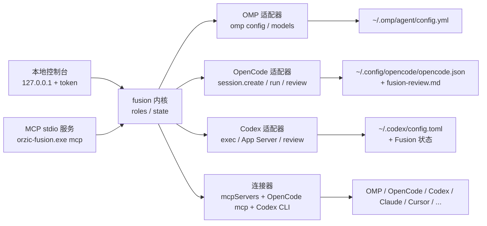

# Orzic for fusion

一个本地控制台 + MCP 服务：把「哪个角色用哪个模型、用多强的思考」集中管理，并把这个 MCP 服务注册到不同 Agent。

**当前已适配 OMP、OpenCode 与 Codex**，其余 Agent 通过适配器逐步接入；MCP 注册支持 OMP、OpenCode、Codex 与标准 JSON `mcpServers` 客户端。

## 它解决什么

- OMP 的 `modelRoles` 是一串 `provider/model[:thinking]` 字符串。模型 ID 本身可能含 `:`（例如 `magpie/work/global:deepseek-v4.1-flash-sg`），手改容易把模型名拆错。
- OpenCode 的模型选择是 `provider/model#variant`，与 OMP 的 `:` 语法不同；同一套「规划/执行/验收」需要分别保存、分别应用。
- 规划 / 执行 / 顾问 / 轻量 / 深思 / 审查这些角色散落在不同配置项里，没有一个地方能同时看到「角色 → 模型 → 思考强度」。
- 每个 Agent 的 MCP 配置格式不同，接入一次要改一次文件。

本程序把这三件事收拢到同一份内核：GUI 与 MCP 工具读写同一套配置，不存在第二份真源。

## 当前范围

| 能力 | 状态 |
| --- | --- |
| OMP 角色读取 / 保存（`modelRoles`） | 已完成 |
| OMP 思考强度（角色级 `:<level>` + 全局 `defaultThinkingLevel`） | 已完成 |
| OMP 路由开关（`plan.enabled` / `advisor.enabled` / `task.prewalk`） | 已完成 |
| 每轮路由（混合 C：新需求先规划，纯问题直接执行） | 已完成 |
| OMP 扩展：每轮切模型/思考、规划门禁、PLAN.md 交接 | 已完成 |
| 手动验收（diff + review 模型 + PASS/REWORK） | 已完成 |
| 自动验收 / REWORK 自动回喂（按工作区开启） | 已完成 |
| 控制台标志 / Windows 图标 | 已完成 |
| MCP stdio 服务（`orzic-fusion.exe mcp`） | 已完成 |
| MCP 注册：OMP、Claude Desktop、Cursor、Windsurf、Antigravity、Gemini CLI、自定义 JSON | 已完成 |
| OpenCode MCP 注册（`mcp.fusion`，兼容 v2 嵌套/扁平） | 已完成 |
| OpenCode 角色模型（`plan` / `execute` / `review`，per-turn `--model` + variant） | 已完成 |
| OpenCode 受控会话（plan → 用户确认 → build，同会话） | 已完成 |
| OpenCode 只读验收（Fusion-owned `fusion-review` agent） | 已完成 |
| OpenCode 自动验收 / REWORK 回喂 | 未接入；当前仅手动验收 |
| Codex MCP 注册（`codex mcp add/remove`，保留 TOML） | 已完成 |
| Codex 角色模型（`plan` / `execute` / `review`，按回合传模型/effort） | 已完成 |
| Codex 受控会话（隔离规划 → 确认 → 同 thread 执行） | 已完成 |
| Codex 只读验收（`codex exec --ignore-user-config` + 严格 JSON） | 已完成 |
| Codex 自动验收 / REWORK 回喂 | 未接入；当前仅手动验收 |
| Zed `context_servers` 自动写入 | 仅提供手动片段 |

## 界面

控制台按「夜间操作台」重排，功能入口和保存/门禁语义不变：

- 窗口最上面的系统标题栏为 `#000000`，通过 `<meta name="theme-color" content="#000000">` 设置；标题使用零宽字符，避免回退显示地址；`favicon` 保持透明，标题栏没有文字和图标。激活和失焦状态都实测为纯黑。
- 下面纯黑页面顶栏左侧放新 Logo 的白色抠图和加粗 `Orzic`：Logo 50px、字标 40px/700，两者底边齐平，并带轻量阴影；右侧保留版本/刷新/退出。窄窗不缩字标，空间不足时操作换行。
- 五个页面共用标题和细规则，但版式分开：角色页用短标题「模型」，视觉重点是「规划 / 执行 / 验收」错落条带 + 角色行；连接页是目录列表；OpenCode/Codex 先角色和任务，再真实输出；概览是信息板。
- 项目级设计规则同时安装到用户级 `~/.omp/agent/skills/fusion-ui-design/SKILL.md`，并在项目目录保留一份；OMP 的 RPC 命令列表已出现 `skill:fusion-ui-design`。
- 角色页的 `01 / 02 / 03` 只对应真实流程，是 `aria-hidden` 装饰，不是可点按钮。
- 资源仍全部嵌入 EXE，同源 CSP；没有 CDN、远程字体、GSAP 运行库或外部图片。动效只做页面进入和状态反馈，并遵守 `prefers-reduced-motion`。
- 项目级设计规则在 `.omp/skills/fusion-ui-design/SKILL.md`，供后续改版和新会话复用。

截图：`screenshots/desktop.png`（1365×768）、`screenshots/mobile.png`（390×900）。

## 架构



- `src/roles.rs`：选择器编解码、角色合并。**已知模型选择器优先于后缀拆分**，因此含 `:` 的模型 ID 不会被误判为思考强度。
- `src/route.rs`：每轮路由内核（混合 C）、会话粘性、角色缓存、OMP 扩展安装。
- `extensions/fusion-loop.ts`：OMP 扩展。`before_agent_start` 调 `route`，切模型/思考；规划阶段拦截副作用工具；`PLAN.md` 写入成功后交接执行。
- `src/agents/omp.rs`：OMP CLI 适配器。读取 `omp config list --json` / `omp models ls --json`，写入走 `omp config set`，不直接重写 `config.yml`。
- `src/agents/opencode.rs`：OpenCode v2 适配器。用 `opencode api session.create` 显式绑定工作区，`opencode run --format json` 跑规划/执行/验收；角色选择按回合应用 `--model provider/model#variant`。
- `src/agents/codex.rs`：Codex 适配器。`model/list` 读模型与思考档；规划/验收用 `codex exec --ignore-user-config` 隔离 MCP/插件/联网，执行用 App Server `thread/resume` + `turn/start` 写目标工作区；`thread/read` 回读实际模型/effort。
- `src/connectors.rs`：OMP/桌面端只合并 `mcpServers.<name>`；OpenCode 合并 `mcp.fusion`（已有 `mcp.servers` 时用嵌套形式）；Codex 通过 `codex mcp add/remove` 写入 `~/.codex/config.toml`，只更新可证实属于 Fusion 的条目。写前备份，保留其他键、provider 密钥与 `enabled` 等非 schema 键。
- `src/mcp.rs`：JSON-RPC stdio 服务。
- `src/ui_server.rs` + `src/ui/`：仅监听 `127.0.0.1`，每次启动生成随机 token；页面关闭后自动退出。

## 三部门与角色分派

控制台按三个部门分组，每个角色独立保存模型与思考强度：

| 部门 | 角色 | 当前用途 |
| --- | --- | --- |
| 规划部 | `plan`（主）、`slow`（深度分析） | 新愿望先进入规划；`slow` 供深入调研 |
| 执行部 | `default`（主）、`smol`（轻量） | 按 `PLAN.md` 执行；`smol` 供轻量任务 |
| 验收部 | `review`（主）、`advisor`（每轮顾问） | 角色可独立配置；自动验收/回喂可按工作区开启 |

OMP 里已有的其他角色会出现在「自定义角色」。每张角色卡独立保存，保存一个角色不会重置其他角色。

保存反馈：保存成功后按钮变为「已保存」，状态栏显示「已保存到 OMP · HH:MM:SS」；没有改动时显示「已同步」，按钮置灰表示当前没有待保存内容。

本轮路由实际只切换 `plan` 与 `default`；`slow` / `smol` 由 OMP 的子任务使用，`review` / `advisor` 由验收部独立配置，自动验收/回喂可按工作区开启。

## OpenCode 接入

控制台新增 **OpenCode** 页签，包含连接状态、三个角色模型和受控会话。

### MCP 注册

- 写入用户全局 `~/.config/opencode/opencode.json` 的 `mcp.fusion`：
  ```json
  {
    "mcp": {
      "fusion": {
        "type": "local",
        "command": ["C:\\path\\to\\orzic-fusion.exe", "mcp"],
        "disabled": false
      }
    }
  }
  ```
- 现有文件若已有 `mcp.servers`，则写入嵌套形式；两种形式都不改其他 MCP、provider 密钥或 `enabled` 键。
- 同目录存在 `opencode.jsonc`、文件解析失败或 `fusion` 已被非 Fusion 条目占用时，拒绝写入，只显示可复制片段。写前备份。
- 已验证 `opencode mcp list` 显示 `fusion connected`，并由 OpenCode 实际调用 `tools.fusion.fusion_status` 成功。

### 角色模型

- OpenCode 页签提供 `plan` / `execute` / `review` 三个角色，保存到 Fusion 状态 `~/.omp/agent/orzic-fusion-opencode.json`。
- 每轮通过 `opencode run --model provider/model#variant` 应用，不写 OMP `modelRoles`，也不改 OpenCode 根级默认模型。
- 模型目录来自 `opencode api get /api/model`，variant 来自模型自身的 `variants`；模型或 variant 失效时保存会明确报错。
- 只读验收使用 Fusion-owned `~/.config/opencode/agents/fusion-review.md`，权限规则禁止 edit/shell/subagent/webfetch/websearch；不覆盖非 Fusion 的同名文件。

### 受控会话

1. 填写工作区与任务，点「开始规划」。Fusion 用 `opencode api session.create` 显式把会话绑定到该工作区，再用 `plan` agent 运行。
2. 规划完成后按钮变为「确认并执行」；未确认不会进入执行。
3. 确认后在同一会话用 `build` agent 和 `execute` 角色模型运行。
4. 执行完成后可点「验收」；Fusion 收集该工作区 diff，用 `fusion-review` 只读 agent 返回 PASS/REWORK。
5. 结果保存在 OpenCode 页签，不覆盖 OMP 上一次验收；OpenCode 当前不自动回喂。

已验证：临时 Git 仓库的规划与执行会话 `location.directory` 指向该临时仓库；规划使用 `plan` + `#high`，执行使用 `build` + `#low`；验收使用 `fusion-review` + `#low` 并返回 PASS。

### 边界

- 只管理 Fusion 创建的会话，不接管用户已打开的 OpenCode 终端/桌面会话。
- 不扫描或停止用户进程；会话通过 OpenCode 共享服务运行，认证由 OpenCode CLI 处理。
- OpenCode 自动验收/回喂尚未接入；当前只有手动验收。
- 只写纯 JSON 全局配置；不写 JSONC，不写远程/项目级配置。

## Codex 接入

控制台新增 **Codex** 页签，包含连接状态、三个角色模型和受控会话。

### MCP 注册

- 通过 Codex 自带命令写入 `~/.codex/config.toml`：
  ```toml
  [mcp_servers.fusion]
  command = "C:\\path\\to\\orzic-fusion.exe"
  args = ["mcp"]
  ```
- 使用 `codex mcp get/list --json` 检查，`codex mcp add/remove` 修改；不手写 TOML 合并器，保留其他表、注释和格式。写前备份到 `~/.codex/orzic-backup/`。
- 只更新可证实属于 Fusion 的 `stdio` 条目（可执行文件名以 `orzic-fusion` 开头且参数含 `mcp`）；同名非 Fusion 条目拒绝覆盖/删除。已是当前入口则不重写。
- `CODEX_HOME` 可覆盖默认 `~/.codex`；注册检查与「Codex 已加载工具」分开显示。

### 角色模型

- Codex 页签提供 `plan` / `execute` / `review`，保存到 Fusion 状态 `~/.omp/agent/orzic-fusion-codex.json`。
- 模型目录来自本机 App Server `model/list`，思考档来自每个模型的 `supportedReasoningEfforts`；保存和发回合前校验，失效时明确报错。
- 规划与验收用 `codex exec --ignore-user-config --ignore-rules --json -s read-only -c web_search=disabled`，不加载用户的 MCP/插件配置；执行用 App Server `thread/resume` + `turn/start`，显式 `workspaceWrite` 且只写目标工作区。
- 执行后通过 `thread/read` 回读线程的 `model` / `reasoningEffort`，界面同时显示请求值和实际值；模型重路由事件也会记录。

### 受控会话

1. 填写工作区与任务，点「开始规划」。Fusion 用隔离 `codex exec` 创建 thread，规划只读。
2. 规划完成后按钮变为「确认并执行」；后端同时校验会话 ID、工作区、任务、计划指纹和阶段。
3. 确认后用 App Server 恢复同一 thread，以执行角色模型/effort 和 `workspaceWrite` 运行。
4. 执行完成后可点「验收」；Fusion 收集该工作区 diff，用独立隔离的 Codex 只读会话和严格 JSON schema 返回 PASS/REWORK。
5. 结果保存在 Codex 页签，不覆盖 OMP/OpenCode 上一次验收；Codex 当前不自动回喂。

已验证：`codex-cli 0.172.0`，本机读取 10 个模型；临时 Git 仓库规划 `gpt-6.2-sol#high`、执行 `gpt-6.2-sol#low`，`thread/read` 回读实际值一致；`note.txt` 只追加 `done`；独立验收返回 PASS。

### 边界

- 只管理 Fusion 创建的 thread，不接管用户已有 Codex 终端/桌面会话。
- 规划/验收的 `--ignore-user-config` 会忽略用户自定义 provider；需要自定义 provider 的模型可能在规划/验收阶段不可用，界面会报错，不会偷偷换模型。
- 执行阶段允许用户配置的 MCP/插件，但沙箱限制为目标工作区写入；规划和验收不加载它们。
- Codex 自动验收/回喂尚未接入；当前只有手动验收。

## 界面

控制台按 [unslop](https://github.com/heydamir/unslop)（Damir Sokolovsky，CC BY 4.0）重排：左侧导航 + 流式内容，石墨中性色 + 单一强调色，红/绿/琥珀只表状态。桌面为双列角色卡，窄窗收为单列；模型选择、保存、验收、连接与概览操作保持原样。标志来自用户提供的白色双环。

## 是否需要常驻 EXE

不需要。

- **每轮路由**：OMP 扩展在每条消息前调用一次 `orzic-fusion.exe route`，读完即退出（毫秒级）。
- **控制台**：只在改配置时打开；页面关闭或点「退出服务」后本地服务退出，后台冻结/切走不会误杀。
- **MCP 服务**：由接入的 Agent 按需启动，不是常驻进程。
- 只要 `bin/orzic-fusion.exe` 还在安装时记录的路径，路由就能工作；移动 exe 后重新运行 `install-omp`。

## 构建与运行

已构建的二进制：`bin/orzic-fusion.exe`（`target/` 已清理，需要调试或重编时再构建）。

```bash
cd "Orzic for fusion"
cargo build --release
```

```text
orzic-fusion.exe                启动桌面控制台（无参数）
orzic-fusion.exe --ui           启动控制台（--port <端口> --no-open）
orzic-fusion.exe mcp            启动 MCP stdio 服务
orzic-fusion.exe status         输出角色、模型与连接状态（JSON）
orzic-fusion.exe route          从 stdin 读取用户消息，输出本轮模式与模型
  --session <id> --cwd <仓库目录>
  --event refresh|plan-written|rework|reset
orzic-fusion.exe install-omp    安装并登记 OMP 扩展（每轮路由 + 规划门禁）
orzic-fusion.exe uninstall-omp  移除 OMP 扩展登记
orzic-fusion.exe accept         手动验收（--cwd <工作区目录>）
  --auto                        仅在已开启自动验收的工作区运行
  --json                        输出紧凑 JSON（供扩展调用）
orzic-fusion.exe connect        注册到目标平台
  --target omp,claude-desktop,cursor,windsurf,antigravity,gemini-cli | all
  --custom <mcpServers JSON 路径> --label <名称>
  --off                         断开而不是连接
```

控制台使用 Edge/Chrome 的 `--app` 窗口打开；没有可用浏览器时退回系统默认浏览器。

## 角色与思考强度

角色清单：`plan`、`default`（执行）、`advisor`、`smol`、`slow`、`review`。OMP 配置里存在的其他角色会原样保留并显示为「自定义」。

保存格式：

```text
provider/model                     # 跟随全局 defaultThinkingLevel
provider/model:high                # 角色级思考强度
magpie/work/global:deepseek-v4.1-flash-sg
magpie/work/global:deepseek-v4.1-flash-sg:xhigh
```

解析顺序：

1. 整个字符串是模型目录中的已知选择器 → 模型，无角色级强度。
2. 末尾 `:<level>` 是合法强度且去掉后缀后是已知选择器 → 拆分。
3. 否则整串视为模型。

支持的强度：`off`、`minimal`、`low`、`medium`、`high`、`xhigh`、`max`、`auto`。模型自身声明了 `thinking` 列表时，界面只显示该模型支持的档位；`reasoning: false` 的模型不显示强度选择。

### 按模型档位与 token 成本

- 每个角色独立保存 `provider/model:thinking`；改一个角色不会影响其他角色。
- 模型声明了 `thinking` 档位时，只显示这些档位（例如 `devin/swe-2` 只有 medium/high/max）。
- 模型未声明档位时，显示 OMP 全局档位，并标注“模型未声明档位，按 OMP 全局档位”。
- `reasoning: false` 的模型显示“该模型不支持思考强度”，不会写入无效档位。
- 角色卡与模型选择器显示上下文窗口、输入/输出单价（每 1M token）。单价来自 OMP 模型目录；没有报价的模型显示“成本未知”。

模型目录来自 `omp models ls`，会随 provider 登录状态变化。Fusion 缓存 5 分钟，也可以点「刷新模型」立即刷新；退出登录的 provider 会从选择器消失。默认保留所有仍可用的模型（例如 Magpie 的 23 个）；`magpie/devin/*` 属于 Magpie 路由，仍会保留。

省 token 的典型配法：

| 角色 | 建议 |
| --- | --- |
| 规划 `plan` | 用较强模型 + 较高思考，但只在每个任务开始时调用一次 |
| 执行 `default` | 用性价比模型 + 中/低思考；简单任务交给 `smol` |
| 验收 `review` | 需要审查时才用高思考，避免每句话都跑 |
| `slow` | 只给真正需要深入分析的任务 |

思考档影响的是推理/输出 token，实际账单还取决于上下文长度和轮数；界面显示的是单价，不是单次预测。

## 每轮循环与规划逻辑（混合 C）

安装扩展后，每条消息在模型运行前都会走 `before_agent_start` → `orzic-fusion route`：

1. `/plan`、`/exec` 显式指令最优先。
2. 回到规划短语（重新规划、评估、先别执行…）→ 规划。
3. 继续执行短语（继续、开始实现、按计划…）→ 执行；若当前在规划且 `PLAN.md` 未写入，仍留在规划。
4. 同一轮出现“另外 / 再加 / 新增”等新需求 → 回到规划。
5. 纯问题（为什么、怎么、是否…且没有改动动词）→ 直接执行；规划阶段的问题仍由规划模型回答。
6. 新的改动请求（帮我、做一个、实现、修复、改成、按截图…）→ 规划。
7. 其余沿用当前模式；新会话默认规划。

**规划阶段**

- 切到 `modelRoles.plan`；未配置时回退 `modelRoles.default` 并明确提示。
- 只读：`bash` / `eval` / `task` 被拦截；写工具只允许 `PLAN.md`。
- 计划必须非空写入仓库根目录 `PLAN.md`；成功后同一轮切到 `modelRoles.default` 执行。
- 规划模型不可用时中止本轮，不静默换模型。

**执行阶段**

- 使用 `modelRoles.default`。
- 新的改动请求会重新进入规划，避免“许愿式需求”被顺手做掉。
- 纯问答直接回答，不触发规划。

状态保存在 `~/.omp/agent/orzic-fusion-route.json`：规则、角色缓存、每个会话的模式。扩展安装在 `~/.omp/agent/extensions/fusion-loop.ts`，并登记到 OMP 的 `extensions` 配置。

**为什么默认先规划**：用户用自然语言 + 截图表达目标，不写代码。新需求先由规划模型复述成“效果 + 验收标准 + 步骤”，写入 `PLAN.md` 后才允许改文件；这样一句话不会在执行阶段被直接做偏或漏掉。纯问答和明确的“继续执行”不会重复规划。

## 手动验收

验收部里点「运行验收」：

1. 读取工作区 `git diff HEAD`，并附带未跟踪的文本文件（排除 `PLAN.md`、`.omp`、`_archive`、`node_modules`、`target`）。
2. 读取 `PLAN.md` 作为计划与验收标准。
3. 用 `review` 角色模型（未配置时回退 `advisor` / `default`）输出 JSON：`pass` 或 `rework` + findings。
4. 验收进程带一个 `orzic-judge.yml` overlay 关闭 advisor，避免评审时再触发顾问模型。
5. 结果保存到 `~/.omp/agent/orzic-fusion-acceptance.json`，刷新页面后仍显示。

命令行：

```text
orzic-fusion.exe accept --cwd <工作区目录>
```

MCP 工具：`fusion_accept`。

## 自动验收与回喂

默认关闭，按工作区开启。验收部勾选「自动验收此工作区」；需要自动返工时再勾「REWORK 自动回喂（最多 2 轮）」。设置保存在 `~/.omp/agent/orzic-fusion-auto.json`。

触发条件：

- OMP 主会话在 `execute` 阶段结束，且 `agent_end` 没有 `willContinue` / `awaitingAsyncWork`；
- 工作区有可验收 diff（只有 PLAN.md 或没有改动会 SKIP，不调用模型）；
- 与**该工作区**上次已接受的评审输入不同（指纹含规范化工作区、PLAN.md、diff、review 模型/思考档位；只有 pass/rework/skip 视为已验收，stale/failed 会重试）；
- 同一时间只允许一个验收（锁文件）。

结果：

- PASS / REWORK 显示在验收部；自动结果带「自动」标记。
- REWORK 且开启回喂时，findings 交回**原会话**，走 `default` 执行模型；最多 2 轮。
- 新用户消息会取消正在进行的自动评审；工作区在评审期间变化返回 STALE，不回喂。
- 关闭回喂时只显示结果。
- 多工作区各自保存最近指纹，交替验收不同工作区不会互相顶掉去重记录。
- 取消评审时，Windows 上已经发出的 OMP 请求可能已产生费用；Fusion 只停止后续结果注入。
- 评审对象是扩展收到的会话 cwd；同一 OMP 会话切换工作区时以当前 cwd 为准。

命令行（供扩展调用）：

```text
orzic-fusion.exe accept --auto --json --cwd <工作区>
```

自动验收需要重新运行 `install-omp` 并让 OMP 重新加载扩展（新会话或重启 OMP）。

## 标志与 Windows 图标

- 新 Logo 源图是用户提供的 210×210 PNG。处理时只提取白色图形：以像素最小通道做透明度阈值，背景和纹理全部透明，裁到 158×156 的紧凑画布，保存为 `src/ui/logo.png`。
- `src/app.ico` 从同一透明图形生成，带轻量投影，包含 16/32/48/256px 帧（256px 为 PNG 压缩）；`build.rs` 用 `llvm-rc` / `rc.exe` 编译 `src/app.rc`，嵌入 `orzic-fusion.exe`。
- 自动打开 Edge 窗口后，`src/ui_server.rs` 的 `win_icon` 模块等待新应用窗口出现，再设置 `WM_SETICON`：`ICON_BIG` 从 EXE 资源 1 加载新图标，`ICON_SMALL` 置空。任务栏显示新图形，标题栏仍无小图标；实测通过，未改原生壳。
- `src/ui/favicon.png` 保持 64×64 全透明，通过 `/favicon-v2.png` 提供，避免系统标题栏图标回来。应用窗口继续使用默认 Edge 配置，不新建独立 `--user-data-dir`，避免账户同步弹窗。

## MCP 工具

| 工具 | 作用 |
| --- | --- |
| `fusion_status` | OMP 路径/版本、全部角色、路由开关、模型目录、连接器状态 |
| `fusion_models` | 列出模型与思考档位；`force=true` 重新抓取 |
| `fusion_roles_set` | 设置单个角色（`model` 为空即清除） |
| `fusion_save` | 批量保存角色 / 开关 / 全局强度 |
| `fusion_resolve` | 按 `plan/execute/review/smol/slow` 解析出当前选择器（供其他 Agent 适配器消费） |
| `fusion_route` | 每轮路由：输入消息，返回 `plan/execute`、角色、模型与思考强度 |
| `fusion_install_omp` | 安装并登记 OMP 每轮路由扩展 |
| `fusion_accept` | 手动验收：收集 diff，用 review 模型返回 PASS/REWORK |
| `fusion_connect` | 查看 / 连接 / 断开 MCP 注册（含 OpenCode、Codex） |
| `fusion_open_console` | 启动控制台 |

资源：`fusion://status`、`fusion://models`。

接入示例（标准 `mcpServers`）：

```json
{
  "mcpServers": {
    "fusion": {
      "command": "C:\\path\\to\\orzic-fusion.exe",
      "args": ["mcp"]
    }
  }
}
```

Zed 的 `context_servers` 仍只提供手动片段；Codex 已可在「MCP 连接」中直接连接/断开，也可复制 `[mcp_servers.fusion]` TOML。

## 环境变量

| 变量 | 用途 |
| --- | --- |
| `ORZIC_AGENT_DIR` | 覆盖 OMP agent 目录（默认 `~/.omp/agent`） |
| `ORZIC_OMP_BIN` | 指定 `omp` 可执行文件 |
| `ORZIC_OPENCODE_BIN` | 指定 `opencode` 可执行文件 |
| `ORZIC_CODEX_BIN` | 指定 `codex` 可执行文件 |
| `CODEX_HOME` | Codex 配置与认证目录（默认 `~/.codex`） |
| `ORZIC_FUSION_EXE` | 注册 MCP 时写入的路径（默认当前 exe） |

## 验证记录

- `cargo test`：47 个单元测试通过（选择器解析、角色合并、模型目录/成本解析、连接器合并/拒绝覆盖、OpenCode 扁平/嵌套配置、Codex 条目归属、Codex 模型/effort 校验、Codex exec JSONL 解析、严格验收 JSON、路由分类、验收 JSON 解析、工作区键规范化、评审指纹、MCP 协议）。
- 真实 OMP：退出 Devin 前读取到 1130 个模型；退出后实时目录 33 个（provider: magpie、openai-codex），Fusion 显示 33 个。
- 真实写入：临时把 `smol` 设为 `devin/swe-2:high`，`omp config get modelRoles` 立即反映；清除后 `config.yml` 与写入前逐字节一致。
- 真实路由：新需求 → `plan`；纯问题 → `execute`；`PLAN.md` 未写入时“继续执行”仍留在 `plan`；写入后同一会话切换 `execute`；`/exec` 可显式跳过。
- OMP 扩展（事件模拟）：规划模型 `devin/swe-2:high` 被正确切到 `devin/swe-2` + `high`；`bash`/非 PLAN 写入被拦截；`PLAN.md` 写入后切到执行模型并应用全局 `xhigh`；执行阶段 `bash` 放行。
- 扩展已安装并登记：`~/.omp/agent/extensions/fusion-loop.ts`，OMP `extensions` 配置包含该路径。
- MCP stdio：`initialize` / `tools/list`（10 个工具）/ `fusion_route` 返回正确模式与选择器。
- MCP 注册：OMP `mcp.json` 连接后再断开，文件与原始内容逐字节一致；重复断开不触碰文件。
- 控制台：浏览器实测 6 个角色卡、模型搜索、思考档位、未保存提示、还原、连接器与概览均正常，无控制台错误。
- 三部门布局：规划部 2 卡、执行部 2 卡、验收部 2 卡；plan 与 default 可同时选不同模型/思考档，互不影响。
- 按模型档位：`devin/swe-2` 只显示 medium/high/max；`reasoning:false` 模型显示不支持；未声明档位显示“按全局”。
- 成本显示：`devin/swe-2` 显示“上下文 262K · 输入 $0.500 / 输出 $2.50 / 1M”，模型选择器显示同一单价。
- 登录状态联动：退出 Devin 后，`omp models ls` 只剩 33 个模型（provider: magpie、openai-codex）；Fusion 显示 33 个，`devin/*` 不再出现，`magpie/devin/*` 作为 Magpie 路由保留。
- 保存反馈：保存后按钮显示「已保存」，状态栏显示保存时间；无改动时显示「已同步」；页面刷新后仍能通过 sessionStorage 恢复访问令牌。
- 手动验收：临时仓库把 `add` 从 `a+b` 改成 `a-b`，`magpie/auto/deepseek-v4.1-flash:low` 返回 `rework` + blocker finding（指出 `add(2,3)` 返回 -1，违反 PLAN.md），耗时 43s；测试后 `config.yml` 逐字节还原。
- 手动验收 UI：有 diff 时显示 REWORK 与 findings；干净工作区返回 SKIP；刷新页面后结果仍显示；review 指向已退出的 Devin 路由时快速报错并提示更换模型。
- 验收隔离：调用带 `--config ~/.omp/agent/orzic-judge.yml`（`advisor.enabled=false`），在 advisor 仍指向 Devin 路由时验收仍正常返回 REWORK，不会被顾问模型拖垮。
- 自动验收：临时仓库 `a / b` 的 diff 返回 `rework` + 3 条 findings（`autoRework=true`），第二次同 diff 返回 `duplicate`，未重复调用模型；关闭开关后返回 `disabled`。
- 自动验收 UI：工作区路径输入后自动读取该工作区设置；勾选/取消自动验收与回喂后刷新仍保持；界面显示「自动」结果。
- 扩展事件模拟：`agent_end` 触发自动验收，REWORK 回喂到原会话并走 `default`/`low`；两轮后停止；新用户消息取消进行中的评审；未产生误注入。
- 图标：`target/release/orzic-fusion.exe` 的 `FileDescription/ProductName` 为 Orzic for fusion，可提取 32×32 新图标；图标中白色图形 144 像素、透明 669 像素（32×32），不是旧双环。控制台左上角加载 158×156 透明抠图（`naturalWidth=158`）。
- 布局：1365×768、390×900 与 320×800 均无横向溢出；侧栏/顶部导航、模型选择、保存/还原、验收、连接器与概览可用；窄窗角色卡为单列。
- 新版界面：页面顶栏纯黑，角色页紧凑标题、三段流程条带与角色行可见；连接页为目录列表；保存栏改为静态占位，不再覆盖模型选择控件；Esc 关闭模型弹层并把焦点还给触发器。
- 新版界面实拍：`screenshots/desktop.png`（1365×768）、`screenshots/mobile.png`（390×900）、`screenshots/brand-929.png`（929×976）、`screenshots/brand-390.png`（390×900）、`screenshots/window-final.png`（945×1015 整窗）、`screenshots/window-inactive.png`（失焦整窗）、`screenshots/taskbar-icon-final.png`（任务栏按钮）；页面无新增 console error，键盘焦点可见。
- `bin` 替换：旧文件备份为 `bin/orzic-fusion.exe.bak-20261126-094539`；当前 `bin/orzic-fusion.exe` 与 `target/release` 的 SHA-256 均为 `13de25f6…0684d15`。从 `bin` 启动的 52305 显示新版首页；同一路径的 MCP 握手返回 `2024-11-05`，`tools/list` 返回 10 个工具。
- 品牌处理：系统标题栏激活和失焦均实测纯黑（`0,0,0`）、无文字、图标区无亮像素；页面 Logo 50px、`Orzic` 40px/700，两者底部同为 61px；任务栏按钮实测显示新白色图形，`WM_GETICON` 的 `ICON_BIG` 非空、`ICON_SMALL` 为 0。929px 与 390px 无横向溢出、无 console error；320px 时右侧操作换行。
- OMP 技能发现：用户级 `~/.omp/agent/skills/fusion-ui-design/SKILL.md` 已安装；在仓库外目录运行 `omp --mode rpc`，命令列表包含 `skill:fusion-ui-design`。项目级副本仍保留。

- OpenCode 版本：本机 `opencode v2.4.1`；`opencode mcp list` 显示 `fusion connected`，实际调用 `tools.fusion.fusion_status` 返回 `omp/19.2.0`。
- OpenCode 注册：现有 `opencode.json` 的 `mcp` 扁平映射写入 `mcp.fusion`；其他 MCP、`providers` 密钥与 `enabled` 键保留，写前备份。Fusion 自己的旧路径（如 `target\debug`）可被识别并更新为 `bin`，非 Fusion 同名条目仍拒绝覆盖。
- OpenCode 角色：`plan=magpie/auto/deepseek-v4.1-flash#high`、`execute=...#low`、`review=...#low`；保存后刷新仍保留，非法 variant 被拒绝。
- OpenCode 受控会话：临时 Git 仓库中 `session.create` 的 `location.directory` 指向该临时仓库；规划会话为 `plan` + `#high`，执行会话为 `build` + `#low`，均 `succeeded`。
- OpenCode 验收：`fusion-review` 只读 agent 被加载，验收会话为 `fusion-review` + `#low`；临时仓库 `note.txt` 返回 PASS（1 个文件 / 36 字符 / 11.2s）。
- OpenCode 配置安全：`opencode.jsonc` 存在、双配置或同名非 Fusion 条目时拒绝写入；OpenCode 结果与 OMP 验收分开存储。
- Codex 版本：本机 `codex-cli 0.172.0`，`codex login status` 为 ChatGPT 登录；App Server `model/list` 读取 10 个模型及其 effort。
- Codex 注册：临时 `CODEX_HOME` 中 `codex mcp add` 写入 `[mcp_servers.fusion]`，`codex mcp get --json` 能读回；`connect --target codex --off` 只删除 Fusion 条目。带空格的路径可写入。
- Codex 受控会话：临时 Git 仓库规划为 `gpt-6.2-sol#high`、执行为 `gpt-6.2-sol#low`；执行后 `thread/read` 回读实际 `gpt-6.2-sol` / `low`，`note.txt` 仅追加 `done`。
- Codex 隔离验收：`codex exec --ignore-user-config` 不启动 MCP/插件；严格 JSON schema 返回 PASS（1 个文件 / 119 字符 / 约 9s）；缺少 PLAN.md 时返回 REWORK。
- Codex 失败路径：注入 `turn.failed` 的 fake CLI 后，控制台显示 `Codex exec 失败：fake rate limit; retry later`，不再返回空错误。
- Codex 控制台：Codex 页签在 1365×768 与 390×900 无横向溢出；角色、会话、验收结果与模型选择器可用，无 console error。
- 未在真实 OMP 会话中重启验证自动触发；事件路径用桩程序验证，当前会话需要 `install-omp` 后新会话/重启 OMP 才会加载新扩展。

## 与旧目录的关系

`../Orzic/rust-mcp` 是前身，同时管理 OMP / OpenCode / Codex / Zed 与验收流程。本目录是一次收敛重构：

- 只保留 fusion 需要的内核，OMP 作为第一个适配器；
- 修复了旧实现按最后一个 `:` 拆分会误伤含冒号模型 ID 的问题；
- 连接器只做安全的合并：OMP/桌面端写 `mcpServers`，OpenCode 写 `mcp.fusion`，Codex 走原生 `codex mcp add/remove`；不手写 TOML/JSONC 重写器；
- GUI 与 MCP 共用 OMP 的 `state::build()`；OpenCode 与 Codex 角色/会话使用独立状态文件，不会串写 OMP 配置。

## 下一步

1. OpenCode 自动验收/REWORK 回喂（当前只有手动验收）。
2. Codex 自动验收/REWORK 回喂（当前只有手动验收）。
3. 可选的小模型分类器：规则不确定时再调用，低置信度沿用当前模式。
4. GUI 路由规则编辑；Zed `context_servers` 的安全写入。
5. 在真实 OMP 会话中重启加载新扩展，验证自动验收的端到端触发。
